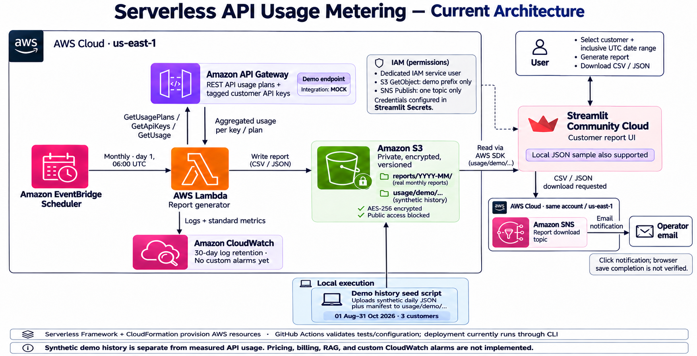

# Serverless API Usage Metering

**Live demo:** [Try the API Usage Metering dashboard](https://serverless-api-usage-metering.streamlit.app/)

Select a sample customer and dates within **August–October 2026** in S3 demo mode
to test report generation. Local sample mode covers **October 2026**.
The frontend supports a local sample or S3 synthetic history. The hosted app requires
its S3 connection settings and dedicated service-account credentials in Streamlit Secrets;
deploying AWS infrastructure alone does not configure those hosted settings.

An AWS-native API usage accounting framework for transparent, traceable, and reliable usage-based billing.

## Problem

Amazon API Gateway provides native API usage metering, but the data is aggregated and primarily designed for quota monitoring rather than detailed billing accountability. This makes it difficult to maintain long-term usage history, apply custom billing rules, explain how billable usage was calculated, and verify usage against request-level activity.

## What We Are Solving

We are building an AWS-native API usage accounting framework that derives billable usage from request-level API activity, applies configurable billing policies, stores durable historical usage records, and reconciles calculated usage with API Gateway's native usage measurements.

## Why We Are Solving It

Usage-based API services need more than a total request count. Engineering, finance, and customers need to understand which requests were considered billable, how usage was calculated, and whether the reported numbers can be independently verified. The goal is to make API usage accounting more transparent, traceable, and reliable.

## Benefits

The framework provides more accurate and explainable usage reporting, long-term historical records, configurable billing logic, independent usage verification, easier discrepancy investigation, and a stronger audit trail for usage-based billing.

## Implementation Status

The current implementation exports API Gateway's aggregated usage measurements to
monthly CSV and JSON reports in S3. Request-level activity ingestion, configurable
billing policies, and reconciliation are planned capabilities and are not yet
implemented. The architecture below describes monthly reporting, the S3-backed
Streamlit demo, and SNS download notifications.

## Architecture



The Lambda implementation follows this diagram: EventBridge Scheduler runs it at
06:00 UTC on the first day of each month. It reports the previous complete UTC
calendar month for API Gateway REST API usage plans in the deployment region.

Streamlit reads the separate synthetic-history prefix directly from the same S3
bucket, generates customer/date-range reports, and publishes download-click events
to SNS for operator email notifications. Its IAM service user can read only the
demo-history objects and publish only to that topic. CloudWatch stores Lambda logs
and provides standard metrics; custom alarms are not configured.

See [the editable architecture and flow details](docs/architecture.md) for the
distinction between measured usage, synthetic demo history, and download alerts.

## Lambda function

`src/app.py` exposes `app.lambda_handler`. It paginates usage plans, API key
metadata, and daily usage, sums used requests per key and plan, and writes:

```text
s3://<bucket>/reports/YYYY-MM/usage.csv
s3://<bucket>/reports/YYYY-MM/usage.json
```

CSV contains month, customer ID/name and mapping status, plan ID/name, API key ID/name,
and total requests used. Customer identity comes from the API key tags `customer_id`
and `customer_name`; missing customer IDs are marked `unmapped` rather than inferred.
Report schema version 2 adds these fields. JSON
also contains the daily used/remaining quota pairs, regional metadata, and totals.
Key values are never requested; reports contain key IDs and names only. Names
that could execute spreadsheet formulas are escaped in CSV.

| Environment variable | Purpose |
| --- | --- |
| `REPORT_BUCKET` | Required destination S3 bucket |
| `REPORT_PREFIX` | Object prefix; defaults to `reports` |
| `USAGE_PLAN_IDS` | Comma-separated plan IDs; Serverless defaults to this stack's demo plan; empty selects all regional plans |

An empty event (`{}`) selects the previous month. To rerun a completed month:

```json
{"month": "2026-09"}
```

The schedule passes its original scheduled timestamp in `time`, so delayed
invocations use the intended month. Current and future months are rejected for
month-based events. Manual `start_date`/`end_date` events may include today, with a
maximum of 31 inclusive days and no future dates. Their results are stored separately
under `reports/date-ranges/YYYY-MM-DD_YYYY-MM-DD/` so monthly reports are preserved.
Reports including today are marked `is_provisional: true` because usage can arrive late.
Failures propagate to Lambda rather than returning a success status. SDK calls
retry transient errors. Collection completes before uploads begin; uploads are
separate operations, so a failure on the second upload can leave only the CSV.
Rerunning writes both files to the same keys. With bucket versioning enabled,
reruns retain previous object versions and incur additional storage.

## Run one sample locally

`samples/api-gateway-usage.json` is the single sample input. Its outer `month` and
`region` fields configure the run. The response sections explicitly identify the
Boto3 operations being simulated:

| Sample section | Real Boto3 call | Purpose |
| --- | --- | --- |
| `get_usage_plans_response` | `get_usage_plans()` | Plan IDs, readable plan names, and quota settings |
| `get_api_keys_response` | `get_api_keys(includeValues=False)` | Key IDs, readable key names, and customer tags |
| `get_usage_responses_by_plan_id` | `get_usage(usagePlanId=...)` | One usage response per plan ID |

These section names organize the local fixture; they are not fields returned by
AWS. Inside each response, AWS names such as `id`, `name`, `usagePlanId`, `startDate`,
`endDate`, and `items` are preserved. Daily usage remains `[used, remaining]`, exactly
as the SDK returns it. The handler calls the same SDK methods in sample and AWS runs;
the local runner substitutes their responses and the upload destination only.

All sample customers use one shared plan, `API Usage - Monthly Metering`, with no
Basic/Premium tiers. API key names identify their owner and environment, such as
`acme-production-api-key`.
Sample IDs are fictional placeholders for AWS-generated identifiers. Match by ID,
not by interpreting a display name; customer IDs stay stable even if names change.
Customer identity is stored in the API key tags, just as it will be
retrieved from API Gateway. No separate customer lookup file is needed.

After installing the dependencies described below, run:

```powershell
.\.venv\Scripts\python.exe scripts/run_sample_report.py
```

The runner invokes the actual `lambda_handler`. Botocore Stubber supplies and
validates the API responses, and a local sink writes the exact bytes that the
handler would upload to S3. It uses dummy credentials and makes no AWS calls.
The production handler still obtains real AWS clients outside this local runner.

It produces one monthly CSV and one monthly JSON, with no daily report files:

```text
output/sample-reports/reports/2026-10/usage.csv
output/sample-reports/reports/2026-10/usage.json
```

| Customer ID | Customer name | Plan | Daily requests | October requests |
| --- | --- | --- | ---: | ---: |
| cust-001 | Acme Ltd | API Usage - Monthly Metering | 10 | 310 |
| cust-002 | Northwind Ltd | API Usage - Monthly Metering | 20 | 620 |
| cust-003 | Contoso Ltd | API Usage - Monthly Metering | 30 | 930 |
| **Total** | | | **60** | **1,860** |

The fixture contains all 31 days. Every key has the same illustrative 10,000-request
monthly operational quota; it does not represent free usage or a pricing tier.
Remaining quotas decrease independently for each key; only used requests are summed.
The intended billing model is monthly usage per customer, with pricing and billable
request rules to be defined later. JSON retains daily details inside the
monthly report for verification. The runner expects this single-page scenario;
pagination remains covered by the existing unit tests. No prices or billing rules
are applied yet. Generated reports are excluded from Git and are plain local files;
the S3 encryption upload parameter is checked, but does not encrypt local files.

## AWS demo API infrastructure

`infrastructure/demo-api.yml` defines the demo API as CloudFormation resources and
is imported by `serverless.yml`. It creates:

- A regional REST API with `GET /usage-demo`, which requires an `x-api-key` header.
- An API Gateway mock integration returning a small dummy response, so no additional
  request-handler Lambda is needed to generate real native API Gateway usage.
- A deployment stage matching `--stage` and one shared `API Usage - Monthly Metering`
  plan. There are no customer pricing tiers.
- Three AWS-generated API keys and their associations with the shared plan:

| Customer ID tag | Customer name tag | API key name in the dev stage |
| --- | --- | --- |
| cust-001 | Acme Ltd | acme-dev-api-key |
| cust-002 | Northwind Ltd | northwind-dev-api-key |
| cust-003 | Contoso Ltd | contoso-dev-api-key |

The customer tags match the sample fixture. AWS generates the real plan/key IDs;
the fixture's IDs and historical usage counts are not imported. The same SDK calls
used in the local sample retrieve the deployed metadata and measured traffic.
The reporting Lambda defaults to this stack's actual demo plan ID. An explicit
`--param="usagePlanIds=..."` overrides that selection; an empty override selects
all regional plans, as before.

Every customer key has the sample's illustrative 10,000-request monthly quota and
the same throttling settings. These are operational settings, not free usage or
pricing rules. AWS quotas/throttles are best effort and are not guaranteed cost caps.
API caching is disabled. Requests, storage, and logs can incur normal AWS charges.
The endpoint serves only dummy data; API keys identify usage and are not a customer
authentication mechanism. It does not expose customer reports or invoke the reporter.

### Validate and deploy the demo

Packaging is local; only the deploy command creates AWS resources. Configure the
intended AWS account, Serverless authentication, and region first. The configured
Python 3.15 Lambda runtime currently has AWS preview status as noted below.

```powershell
# Build infrastructure and validate the generated CloudFormation template.
npm run package -- --stage dev --region us-east-1
cfn-lint .serverless/cloudformation-template-update-stack.json

# Create/update the demo API together with the reporting Lambda, bucket, and schedule.
npm run deploy -- --stage dev --region us-east-1

# Display endpoint, usage plan ID, and customer API key IDs; no secret values are output.
npx serverless info --stage dev --region us-east-1 --verbose
```

The stack outputs include `DemoApiUrl`, `DemoUsagePlanId`, and the three customer key
IDs. Secret key values are generated by AWS, not committed or placed in stack outputs.
Retrieve a value only through an authorized AWS session when making a test request.

### Generate and inspect real usage after deployment

The following PowerShell example sends **one** Acme request. Wait for API Gateway
key/plan association propagation after deployment before testing. Responses and
usage measurements may not be visible immediately.

```powershell
# Read this dev stack's endpoint and resource IDs.
$demoOutputs = (aws cloudformation describe-stacks --stack-name serverless-api-usage-metering-dev --region us-east-1 | ConvertFrom-Json).Stacks[0].Outputs
$demoApiUrl = ($demoOutputs | Where-Object OutputKey -eq 'DemoApiUrl').OutputValue
$demoPlanId = ($demoOutputs | Where-Object OutputKey -eq 'DemoUsagePlanId').OutputValue
$demoKeyId = ($demoOutputs | Where-Object OutputKey -eq 'AcmeDemoApiKeyId').OutputValue

# Hold the generated secret only in the local session; do not print it or commit it.
$demoApiKey = aws apigateway get-api-key --api-key $demoKeyId --include-value --query value --output text --region us-east-1
Invoke-RestMethod -Method Get -Uri $demoApiUrl -Headers @{ 'x-api-key' = $demoApiKey }
Remove-Variable demoApiKey

# Inspect today's native usage after measurements become available.
$demoDate = [DateTime]::UtcNow.ToString('yyyy-MM-dd')
aws apigateway get-usage --usage-plan-id $demoPlanId --start-date $demoDate --end-date $demoDate --region us-east-1
```

Traffic is recorded on its actual UTC date, not backdated into the October sample.
The monthly schedule includes this traffic after the month closes. For an immediate
Lambda check, use the manual date-range workflow below. Connecting Streamlit to the
live reports is a separate integration.

### Send a counted demo batch and fetch it through Lambda

API Gateway records usage from actual API calls; the fixture is not uploaded as
historical usage. `scripts/generate_demo_traffic.py` makes a deliberately small
batch against the deployed endpoint using the real customer keys:

| Customer | Accepted requests requested per batch |
| --- | ---: |
| Acme Ltd | 5 |
| Northwind Ltd | 10 |
| Contoso Ltd | 15 |
| **Total** | **30** |

```powershell
# Send one batch of real requests. Each rerun adds another batch to AWS usage.
.\.venv\Scripts\python.exe scripts/generate_demo_traffic.py

# Fetch today's usage through the deployed Lambda, without sending new API requests.
.\.venv\Scripts\python.exe scripts/generate_demo_traffic.py --report-only
```

The traffic command saves a timestamped receipt with customer/key IDs, observed
counts before the run, accepted-request counts, and request IDs in `output/live-demo/`.
It never prints or saves API key values. The receipt is updated after each successful
request so partial failures remain inspectable. Traffic is paced, not automatically
retried, and goes only to the stack's verified AWS demo endpoint.

The report-only command invokes the real Lambda with an event such as:

```json
{"start_date": "2026-11-04", "end_date": "2026-11-04"}
```

Lambda fetches native usage and customer tags, calculates totals, and writes encrypted
CSV/JSON to S3. The script downloads those exact files under
`output/live-demo/reports/date-ranges/<start>_<end>/`. Both exports include their date
range, and JSON retains daily details. Outputs and receipts are excluded from Git.
Local downloaded files are plain text; encryption applies to the S3 objects.

AWS measurements may lag accepted traffic. If totals are still catching up, rerun
**only `--report-only`**, which updates the same report keys without adding traffic.
Totals include earlier calls that day, so they may exceed 5/10/15. The sample-only
Streamlit dashboard does not read these live files automatically. No prices or
customer charges are calculated by this check.

API deployments are snapshots. When changing routes or integration settings, bump
the `DemoApiDeploymentV1` logical ID and its stage reference so CloudFormation creates
a new deployment. Remove a demo stack with `serverless remove --stage dev --region us-east-1`
when it is no longer needed. The reports bucket is retained by design and must be
managed separately if you want to stop retaining its reports and object versions.

## Three-month synthetic history in S3

`scripts/seed_s3_demo_history.py` builds historical demo records for **August 1 through
October 31, 2026**. It uses the existing stack's private reports bucket and current
customer/key/plan metadata, while explicitly marking every usage record as synthetic.
It does not add historical traffic to API Gateway or alter its usage counters.

```text
usage/demo/dataset=historical-2026-08_2026-10-v1/
  manifest.json
  date=2026-08-01/usage.json
  date=2026-08-02/usage.json
  ...
  date=2026-10-31/usage.json
```

There are **92 daily JSON files**, each containing all three customers, plus one
manifest. Daily records include the UTC date, customer ID/name, API key ID/name,
usage plan ID/name, requests used, monthly quota/remaining snapshot, a unique record
ID, synthetic-source flags, and `billing_status: not_calculated`. No secret API key
values or prices are included. The normalized daily format is designed for customer
and date filtering; it is not a raw Boto3 response or evidence of actual historical calls.

The data varies by weekday and month, includes explicit zero-usage days, and contains
one labeled synthetic spike for later analysis tests. Monthly quota snapshots reset
on the first day of each month. A zero record means zero test usage; a missing date
must be treated as incomplete coverage, not zero.

The manifest lists all dates, object keys and SHA-256 hashes, expected customer/month
totals, and the total record count. It is uploaded last, after all daily files are
read back and verified. Existing identical objects are reused; differing objects are
never overwritten. All S3 objects use AES256 encryption and synthetic-data metadata.

```powershell
# Generate local copies using the deployed demo identities; no S3 writes.
.\.venv\Scripts\python.exe scripts/seed_s3_demo_history.py

# Generate, upload, and verify the 92 daily files and manifest in the existing bucket.
.\.venv\Scripts\python.exe scripts/seed_s3_demo_history.py --upload
```

Local copies live under `output/synthetic-history/` and are excluded from Git.
No new bucket or permissions are provisioned; the existing Serverless-managed bucket
is reused. This dataset stays separate from `reports/` and real measurements. The
Streamlit frontend can read this dataset using the **S3 demo history** source and
the connection settings in [`frontend/README.md`](frontend/README.md). No AI/RAG call
or billing calculation is performed during seeding or report generation.

## Local Streamlit frontend

The separate [`frontend/`](frontend/README.md) folder contains a customer usage UI.
Select a customer and a start/end date within the sample period, then generate a
report with totals, a per-key breakdown, a daily chart, and CSV/JSON downloads.
Local mode reuses the sample Lambda runner. S3 mode connects directly to the private
historical dataset using the Serverless-defined read-only policy and stack outputs.

```powershell
.\.venv\Scripts\python.exe -m pip install -r frontend/requirements.txt
cd frontend
..\.venv\Scripts\python.exe -m streamlit run app.py
```

Open **http://localhost:8501**. The local sample covers October 2026; S3 history
covers August–October 2026, including cross-month date selections. The UI is excluded
from the Lambda ZIP. See the frontend README for connection setup, tests, and boundaries.

## Dependencies and software versions

Record dependency changes in these files before installing them:

| File | Purpose |
| --- | --- |
| `requirements.txt` | Exact local AWS SDK versions, including transitive dependencies |
| `requirements-dev.txt` | Shared requirements plus the pinned CloudFormation validator |
| `frontend/requirements.txt` | Streamlit and pinned frontend dependencies, included in development installs |
| `package.json` / `package-lock.json` | Serverless npm launcher and locked dependency tree |
| `serverless.yml` | Framework engine 4.46.0 and Lambda runtime Python 3.15 (AWS preview) |
| `.python-version` | Python 3.15 for local version managers and CI |
| `.nvmrc` | Node.js 22.23.4 for local version managers |

Python and Node.js must be installed separately; requirements files install Python
packages, not the interpreters. The version files document the project versions
and can be used by compatible version managers. Git and AWS credentials are needed
for repository operations and deployment. AWS CLI is optional for this project's
Serverless deployment commands.

Install Python packages with `python -m pip install -r requirements-dev.txt` and
JavaScript packages with `npm ci`. For dependency updates, edit the manifest first,
resolve compatible transitive versions, and commit the updated manifests/lockfile
together. Use `npm install` when intentionally updating `package-lock.json`.

The current Lambda ZIP contains only application code and uses AWS's managed SDK.
The Python version pins apply to the local environment; packaging the SDK with the
Lambda would be needed to enforce those same SDK versions in AWS.

## Test locally

Python 3.15 is the configured runtime and matches the installed local interpreter.
GitHub Actions reads this version from `.python-version`. AWS currently lists
Python 3.15 as a preview runtime, without production SLA or Technical Support;
confirm general availability before a production deployment. See the
[AWS runtime list](https://docs.aws.amazon.com/lambda/latest/dg/lambda-runtimes.html).
Install Boto3 locally for the module's AWS
SDK imports. Tests use mocked AWS clients; they do not need credentials or contact AWS:

```powershell
python -m venv .venv
.\.venv\Scripts\Activate.ps1
python -m pip install -r requirements-dev.txt
python -m unittest discover -s tests -v
```

## Build and deploy

Use Node.js 22.23.4 and the Serverless versions declared in the project files. Configure AWS credentials
for the target account. The managed Python Lambda runtime supplies Boto3, so the
function has no additional Python dependencies to package.

```powershell
npm ci
npx serverless login
npm run print
npm run package
cfn-lint .serverless/cloudformation-template-update-stack.json
npm run deploy -- --stage dev --region us-east-1
```

`serverless.yml` provisions the Lambda, an encrypted private S3 bucket with
versioning, an HTTPS-only bucket policy, scoped IAM access, and the monthly
EventBridge Scheduler trigger and 30-day CloudWatch log retention. Packaging
creates local artifacts under `.serverless/`; deployment creates AWS resources.
Serverless Framework v4 requires Serverless authentication or a license key in
addition to AWS credentials. The default stage is `dev` and region is `us-east-1`.
Each stage has its own stack and reports bucket.

To restrict collection to selected usage plans:

```powershell
npm run deploy -- --stage dev --region us-east-1 --param="usagePlanIds=plan1,plan2"
```

The bucket is retained if the stack is deleted. Changing `REPORT_PREFIX` requires
updating the matching S3 write permission in `serverless.yml`.

For a manual invocation of the deployed function:

```powershell
npx serverless invoke --function report --path events/backfill.json --stage dev --region us-east-1
npx serverless info --stage dev --region us-east-1 --verbose
```

Check the invocation result and the bucket for both reports. The stack outputs
shown by `serverless info --verbose` include the bucket name.

## Continuous integration

The pipeline is defined as code in `.github/workflows/ci.yml`. It runs on branch
pushes, pull requests targeting `main`, and manual runs from GitHub Actions.
Python and Node versions come from `.python-version` and `.nvmrc`; dependencies
come from the requirements files and npm lockfile. Action dependencies are pinned
to verified commits directly in the workflow.

Every run installs the dependencies, checks Python package compatibility, runs
the Lambda unit tests, and parses the source YAML. These checks need no AWS or
Serverless credentials. The run summary explicitly states when packaging is skipped.

Authenticated packaging is a separate job, initially disabled. To enable it:

1. Create a Serverless CI access key through your Serverless account and add it as
   the repository Actions secret `SERVERLESS_ACCESS_KEY`. An existing license key
   can instead be stored as `SERVERLESS_LICENSE_KEY`. Do not commit either key.
2. If packaging requires access to AWS state or deployment buckets, provision a
   narrowly scoped packaging role and its GitHub OIDC trust through IaC. Set the
   repository Actions variable `AWS_CI_ROLE_ARN` to its ARN. Restrict the trust to
   this repository's `main` branch and grant only the access packaging needs.
   The workflow references this role; it does not provision it.
3. Set the repository Actions variable `ENABLE_SERVERLESS_PACKAGE` to `true`.
4. Push to `main` or manually run the workflow against `main`.

The packaging job uses `serverless.yml` to build the `ci` stage for `us-east-1`,
validates the generated CloudFormation with `cfn-lint`, and retains the ZIP and
template as Actions artifacts for seven days. It runs only on `main` outside pull
request events; pull requests and other branches receive no packaging credentials.
If packaging is enabled without a Serverless key, the job fails with a setup error.

This pipeline does not run `serverless deploy`, create AWS infrastructure, or
grant itself deployment permissions. Provision AWS roles through reviewed IaC
before enabling cloud access. Automated deployment will be added after a manual
AWS deployment and end-to-end verification.

References: [Serverless CI authentication](https://www.serverless.com/framework/docs/guides/upgrading-v4#authentication-requirement)
and [packaging requirements](https://www.serverless.com/framework/docs/providers/aws/guide/packaging).

## Code documentation

Python functions include docstrings describing their purpose, inputs, outputs,
exceptions, and AWS side effects where applicable. Inline comments explain data
formats and important processing decisions. Place comments on separate lines above
the code they describe, rather than after statements. Tests document their sample inputs
and expected results; `serverless.yml` comments explain deployment settings.
Keep this documentation current when adding or changing code.

JSON files do not support comments, so their roles are described here:

- `events/monthly.json`: empty event; selects the previous complete month.
- `events/backfill.json`: sample explicit month for a historical report.
- `package.json`: npm commands and the Serverless CLI dependency. `print` resolves
  configuration, `package` builds local artifacts, `deploy` creates/updates AWS
  resources, and `test` runs the Python unit tests with the active Python environment.
- `package-lock.json`: generated dependency versions and integrity hashes for npm.

## Reporting boundaries

- This collects regional REST API usage plan data; HTTP APIs, WebSocket APIs, and
  traffic without API keys are outside this report.
- Only keys returned by `GetUsage` appear in the report. Missing key metadata
  leaves a blank name. Historical names/plan membership are not reconstructed;
  deleted plans cannot be queried by this function.
- Usage is aggregated across API stages within a plan. Quota remaining is a daily
  snapshot and is never summed as usage. A key in multiple plans has one row per
  plan; totals are sums of those rows.
- Reports support usage analysis, not AWS invoice reconciliation or a durable
  transaction ledger. No pricing or customer charge calculation is applied.
- API Gateway data availability can affect a report generated soon after month
  end. Rerun a month if late data needs to be incorporated.
- The function collects the report in memory and must finish within Lambda's
  15-minute timeout. Large accounts may need a partitioned workflow.

AWS references: [GetUsage response and pagination](https://docs.aws.amazon.com/boto3/latest/reference/services/apigateway/client/get_usage.html),
[usage plan behavior](https://docs.aws.amazon.com/apigateway/latest/developerguide/api-gateway-api-usage-plans.html),
and [Serverless Framework scheduled events](https://www.serverless.com/framework/docs/providers/aws/events/schedule).
