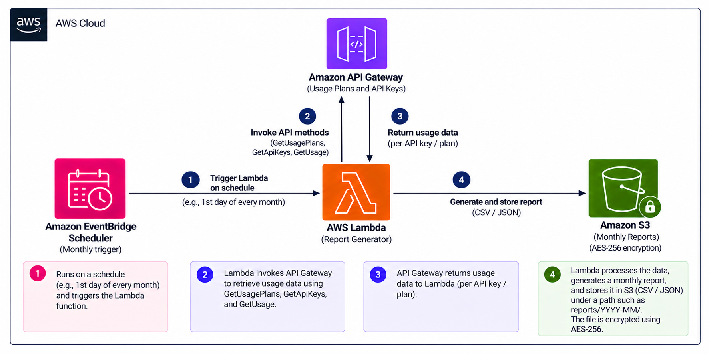

# Serverless API Usage Metering

An AWS-native API usage accounting framework for transparent, traceable, and reliable usage-based billing.

## Problem

Amazon API Gateway provides native API usage metering, but the data is aggregated and primarily designed for quota monitoring rather than detailed billing accountability. This makes it difficult to maintain long-term usage history, apply custom billing rules, explain how billable usage was calculated, and verify usage against request-level activity.

## What We Are Solving

We are building an AWS-native API usage accounting framework that derives billable usage from request-level API activity, applies configurable billing policies, stores durable historical usage records, and reconciles calculated usage with API Gateway's native usage measurements.

## Why We Are Solving It

Usage-based API services need more than a total request count. Engineering, finance, and customers need to understand which requests were considered billable, how usage was calculated, and whether the reported numbers can be independently verified. The goal is to make API usage accounting more transparent, traceable, and reliable.

## Benefits

The framework provides more accurate and explainable usage reporting, long-term historical records, configurable billing logic, independent usage verification, easier discrepancy investigation, and a stronger audit trail for usage-based billing.

## Implementation Status

The current implementation exports API Gateway's aggregated usage measurements to
monthly CSV and JSON reports in S3. Request-level activity ingestion, configurable
billing policies, and reconciliation are planned capabilities and are not yet
implemented. The architecture below describes the current reporting component.

## Architecture



The Lambda implementation follows this diagram: EventBridge Scheduler runs it at
06:00 UTC on the first day of each month. It reports the previous complete UTC
calendar month for API Gateway REST API usage plans in the deployment region.

## Lambda function

`src/app.py` exposes `app.lambda_handler`. It paginates usage plans, API key
metadata, and daily usage, sums used requests per key and plan, and writes:

```text
s3://<bucket>/reports/YYYY-MM/usage.csv
s3://<bucket>/reports/YYYY-MM/usage.json
```

CSV contains month, plan ID/name, API key ID/name, and total requests used. JSON
also contains the daily used/remaining quota pairs, regional metadata, and totals.
Key values are never requested; reports contain key IDs and names only. Names
that could execute spreadsheet formulas are escaped in CSV.

| Environment variable | Purpose |
| --- | --- |
| `REPORT_BUCKET` | Required destination S3 bucket |
| `REPORT_PREFIX` | Object prefix; defaults to `reports` |
| `USAGE_PLAN_IDS` | Optional comma-separated plan IDs; defaults to all regional plans |

An empty event (`{}`) selects the previous month. To rerun a completed month:

```json
{"month": "2026-09"}
```

The schedule passes its original scheduled timestamp in `time`, so delayed
invocations use the intended month. Current and future months are rejected.
Failures propagate to Lambda rather than returning a success status. SDK calls
retry transient errors. Collection completes before uploads begin; uploads are
separate operations, so a failure on the second upload can leave only the CSV.
Rerunning writes both files to the same keys. With bucket versioning enabled,
reruns retain previous object versions and incur additional storage.

## Dependencies and software versions

Record dependency changes in these files before installing them:

| File | Purpose |
| --- | --- |
| `requirements.txt` | Exact local AWS SDK versions, including transitive dependencies |
| `requirements-dev.txt` | Shared requirements plus the pinned CloudFormation validator |
| `package.json` / `package-lock.json` | Serverless npm launcher and locked dependency tree |
| `serverless.yml` | Framework engine 4.46.0 and Lambda runtime Python 3.13 |
| `.python-version` | Python 3.13 for local version managers |
| `.nvmrc` | Node.js 22.23.4 for local version managers |

Python and Node.js must be installed separately; requirements files install Python
packages, not the interpreters. The version files document the project versions
and can be used by compatible version managers. Git and AWS credentials are needed
for repository operations and deployment. AWS CLI is optional for this project's
Serverless deployment commands.

Install Python packages with `python -m pip install -r requirements-dev.txt` and
JavaScript packages with `npm ci`. For dependency updates, edit the manifest first,
resolve compatible transitive versions, and commit the updated manifests/lockfile
together. Use `npm install` when intentionally updating `package-lock.json`.

The current Lambda ZIP contains only application code and uses AWS's managed SDK.
The Python version pins apply to the local environment; packaging the SDK with the
Lambda would be needed to enforce those same SDK versions in AWS.

## Test locally

Python 3.13 is the deployment runtime. Install Boto3 locally for the module's AWS
SDK imports. Tests use mocked AWS clients; they do not need credentials or contact AWS:

```powershell
python -m venv .venv
.\.venv\Scripts\Activate.ps1
python -m pip install -r requirements-dev.txt
python -m unittest discover -s tests -v
```

## Build and deploy

Use Node.js 22.23.4 and the Serverless versions declared in the project files. Configure AWS credentials
for the target account. The managed Python Lambda runtime supplies Boto3, so the
function has no additional Python dependencies to package.

```powershell
npm ci
npx serverless login
npm run print
npm run package
cfn-lint .serverless/cloudformation-template-update-stack.json
npm run deploy -- --stage dev --region us-east-1
```

`serverless.yml` provisions the Lambda, an encrypted private S3 bucket with
versioning, an HTTPS-only bucket policy, scoped IAM access, and the monthly
EventBridge Scheduler trigger and 30-day CloudWatch log retention. Packaging
creates local artifacts under `.serverless/`; deployment creates AWS resources.
Serverless Framework v4 requires Serverless authentication or a license key in
addition to AWS credentials. The default stage is `dev` and region is `us-east-1`.
Each stage has its own stack and reports bucket.

To restrict collection to selected usage plans:

```powershell
npm run deploy -- --stage dev --region us-east-1 --param="usagePlanIds=plan1,plan2"
```

The bucket is retained if the stack is deleted. Changing `REPORT_PREFIX` requires
updating the matching S3 write permission in `serverless.yml`.

For a manual invocation of the deployed function:

```powershell
npx serverless invoke --function report --path events/backfill.json --stage dev --region us-east-1
npx serverless info --stage dev --region us-east-1 --verbose
```

Check the invocation result and the bucket for both reports. The stack outputs
shown by `serverless info --verbose` include the bucket name.

## Code documentation

Python functions include docstrings describing their purpose, inputs, outputs,
exceptions, and AWS side effects where applicable. Inline comments explain data
formats and important processing decisions. Place comments on separate lines above
the code they describe, rather than after statements. Tests document their sample inputs
and expected results; `serverless.yml` comments explain deployment settings.
Keep this documentation current when adding or changing code.

JSON files do not support comments, so their roles are described here:

- `events/monthly.json`: empty event; selects the previous complete month.
- `events/backfill.json`: sample explicit month for a historical report.
- `package.json`: npm commands and the Serverless CLI dependency. `print` resolves
  configuration, `package` builds local artifacts, `deploy` creates/updates AWS
  resources, and `test` runs the Python unit tests with the active Python environment.
- `package-lock.json`: generated dependency versions and integrity hashes for npm.

## Reporting boundaries

- This collects regional REST API usage plan data; HTTP APIs, WebSocket APIs, and
  traffic without API keys are outside this report.
- Only keys returned by `GetUsage` appear in the report. Missing key metadata
  leaves a blank name. Historical names/plan membership are not reconstructed;
  deleted plans cannot be queried by this function.
- Usage is aggregated across API stages within a plan. Quota remaining is a daily
  snapshot and is never summed as usage. A key in multiple plans has one row per
  plan; totals are sums of those rows.
- Reports support usage analysis, not AWS invoice reconciliation or a durable
  transaction ledger. No pricing or customer charge calculation is applied.
- API Gateway data availability can affect a report generated soon after month
  end. Rerun a month if late data needs to be incorporated.
- The function collects the report in memory and must finish within Lambda's
  15-minute timeout. Large accounts may need a partitioned workflow.

AWS references: [GetUsage response and pagination](https://docs.aws.amazon.com/boto3/latest/reference/services/apigateway/client/get_usage.html),
[usage plan behavior](https://docs.aws.amazon.com/apigateway/latest/developerguide/api-gateway-api-usage-plans.html),
and [Serverless Framework scheduled events](https://www.serverless.com/framework/docs/providers/aws/events/schedule).
