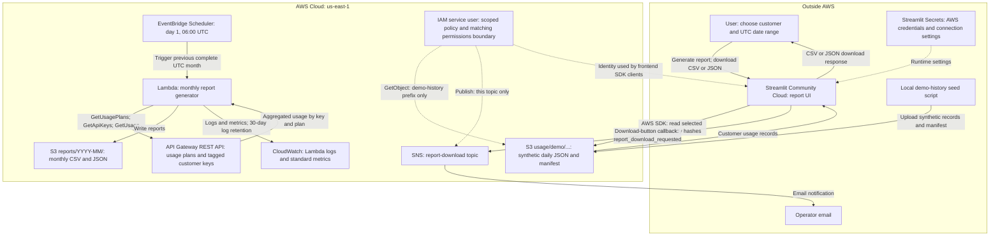

# Current architecture

This diagram describes the deployed AWS reporting infrastructure and the Streamlit
demo integration. AWS resources are defined in `serverless.yml` and the imported
`infrastructure/*.yml` files. GitHub Actions validates the code; AWS deployment
currently runs through the Serverless CLI.

<!-- Keep the data paths separate: measured API usage feeds monthly reports, while the UI reads synthetic history. -->

The two S3 nodes are prefixes in the **same private, encrypted, versioned bucket**,
not separate buckets. Encryption uses S3-managed AES-256 keys and public access is
blocked. The synthetic dataset covers **August 1–October 31, 2026**, with three
customers, 92 daily JSON files, and one manifest. It is uploaded independently of
real API Gateway measurements.

The reporting Lambda reads native API Gateway usage through management SDK calls.
The demo `/usage-demo` endpoint uses an API Gateway MOCK integration; the reporting
Lambda is not its request handler. API key tags identify the customer associated
with each key. Monthly reports cover the preceding complete UTC calendar month;
manual date-range reports use a separate `reports/date-ranges/` prefix.

The Streamlit S3 demo reads synthetic history directly. It verifies source hashes,
filters the selected customer and inclusive UTC dates, and calculates report totals
without invoking the reporting Lambda. A local JSON sample is also supported.
Frontend AWS credentials stay in Streamlit Secrets and the ignored local Secrets
file; their values are never part of the diagram or committed configuration.

Download clicks publish report metadata to SNS and notify the configured operator.
They do not prove that the browser finished saving the file. Report generation and
page rerenders send no event. The report customer is distinct from the requester,
who is anonymous in this demo. Publishing failures show a UI warning while leaving
the download available. Email subscribers must confirm their subscription.

CloudWatch receives the Lambda's logs and standard metrics. There are currently no
custom CloudWatch alarms, dashboard, missing-report checks, or CloudWatch-to-SNS
health alerts. SNS currently serves download notifications only. Pricing, billing
calculations, request-level ingestion, reconciliation, and RAG analysis remain
planned capabilities.

The illustration is generated with the built-in image-generation tool using the
[saved prompt](images/architecture-image-prompt.txt). The Mermaid block above is
the editable architecture source.
